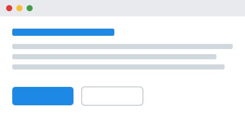

# テスト
<!-- origin: 0 -->

## 色と span
[赤]{color=red} / [#c00000]{color="#c00000"} / [短縮]{color=#0aa} / [不正]{color=pink} / [クラスのみ]{.foo} / [入れ子[内]{color=blue}外]{color=green} / [**太字** と `code`]{color=red} / {not attr} / [リンク](https://example.com)

## アイコン
### 並び
詰めて:icon_test_red::icon_test_blue:、空白 :icon_test_red: :icon_test_blue:、存在しない :icon_none::icon_test_blue:、時刻 10:30:00、`:icon_test_blue:` はコードなのでそのまま。

#### 深い
##### さらに深い（番号なし）

## 改行
日本語の文を途中で
改行しても空白なし。
English lines
keep a space.
[色付き]{color=red}
の前後も同じ。

<!-- pagebreak -->

## 画像

文中の画像  は影なし。
